# Automated Tool Offsetter: vision-based tool presetter for CNC machining centres

[](https://github.com/ameeniszath/automated-tool-offsetter/actions/workflows/tests.yml)

A low-cost **camera-based tool presetter** that measures a cutting tool's **length, diameter and point angle** from a back-lit silhouette, and writes the **Fanuc tool-offset commands (G10)** ready to load into the CNC. It replaces touching off each tool on the machine, or reading a dial-gauge presetter and typing the values in by hand.

| Front: camera on a Z axis with a linear encoder | Back: tool in holder, back light, X/Y stages |
|---|---|
| 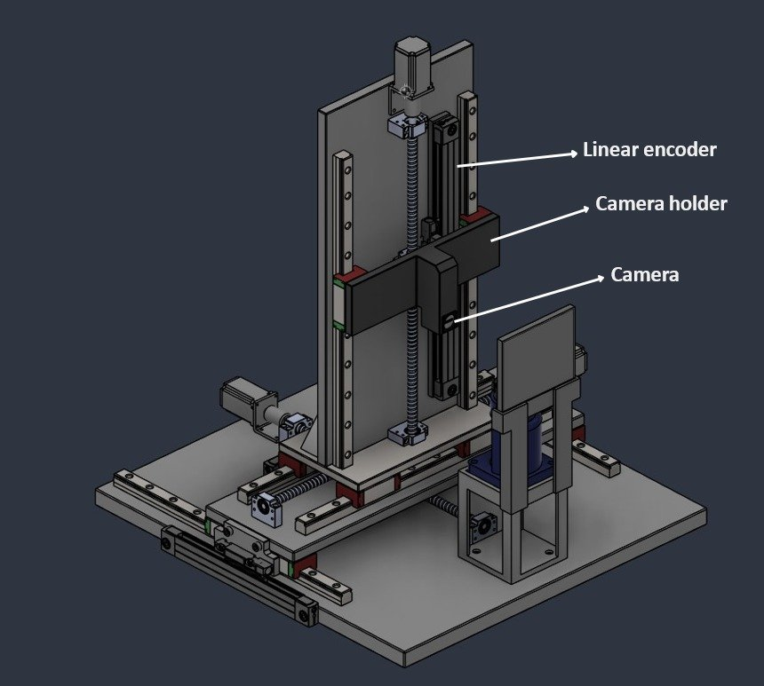 | 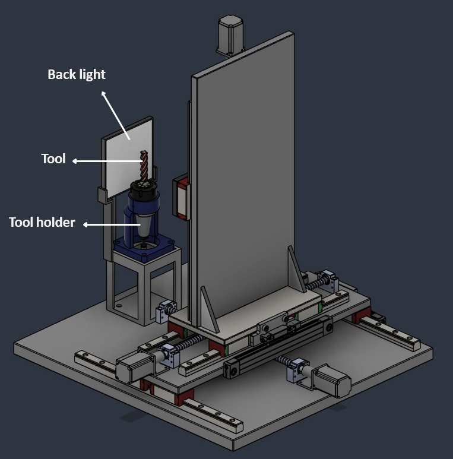 |

**Full Fusion 360 assembly** (`holder_design.f3z`): download from the [Releases page](../../releases) and open in Fusion 360 (File → Open → Open from my computer).

---

## The problem

On a vertical machining centre every tool needs a **length offset (H)** and usually a **radius offset (D)**. The NC program calls them with `G43 H..`, and the values sit in the controller's offset table:

| NC program using G43 H12 | Fanuc 0i offset table: H and D, geometry and wear |
|---|---|
| 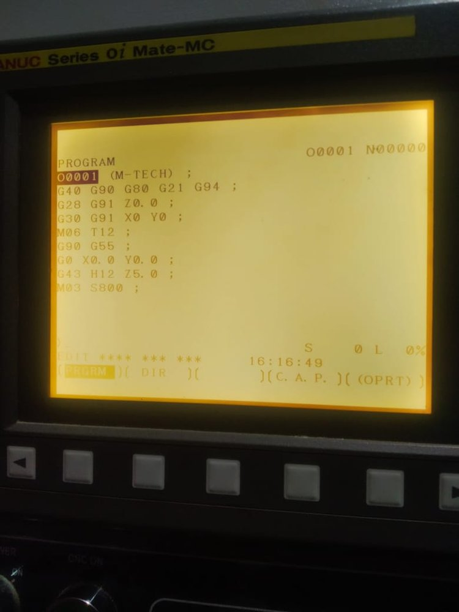 | 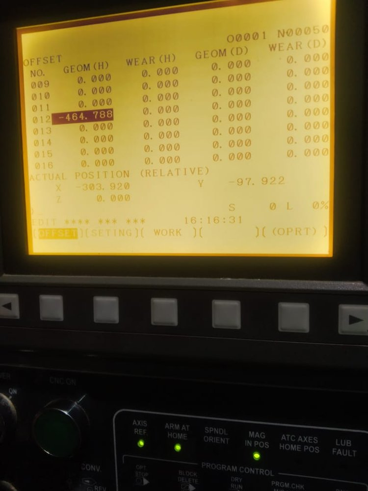 |

How these values are found today:

| Touch-off on the machine | Commercial dial-gauge presetter |
|---|---|
| 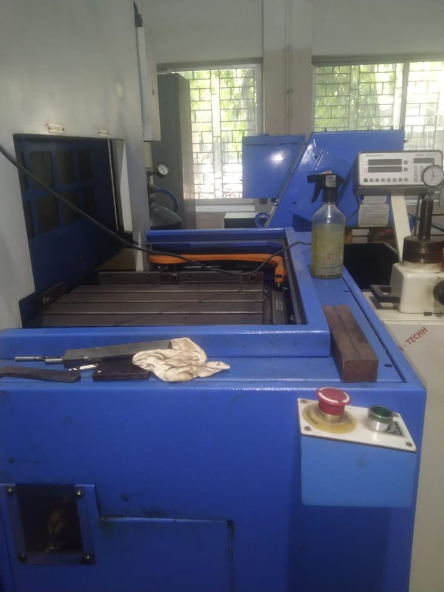 | 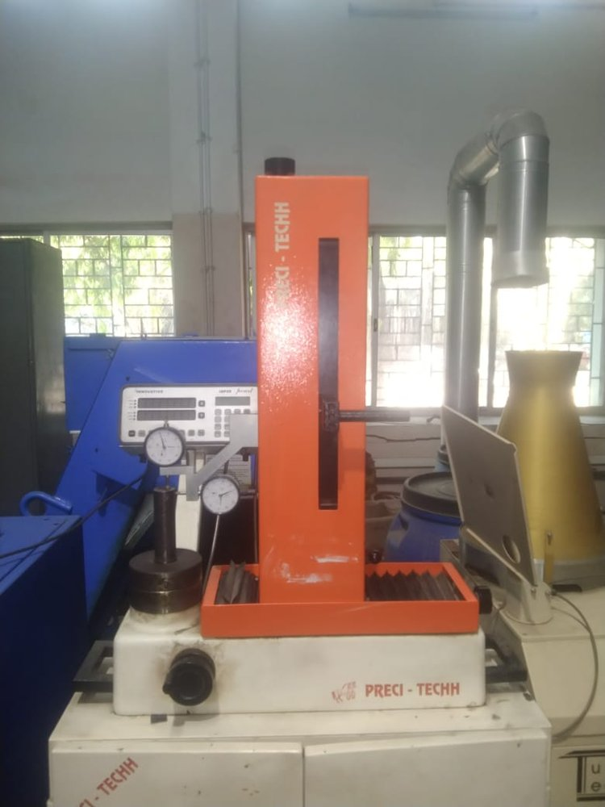 |
| The spindle sits idle, results depend on operator skill, and a typing error can crash the tool | Accurate, but expensive, manual, and the values are still read and typed in by hand |

**Goal:** measure tools **off the machine, optically and automatically**, and produce the offset commands directly.

## What it does

- **Tool length** from the holder's gauge line to the tip, including tools longer than the camera view (camera on an encoder-read Z axis)
- **Tool diameter** (envelope) and **drill point angle**, plus the full **width profile** along the tool
- **Sub-pixel edges**, with the tip found from the **intersection of the cone edges** for pointed tools, so defocus doesn't shorten drills
- **Calibration** from two clicked points or automatically from a **gauge pin**
- **Fanuc G10 output** (offset memory C): H and D, geometry or wear, with *gauge-line* or *touch-off* conventions
- **Automated cycle**: search for the tip, centre it, read the encoder, measure (developed against a simulated station)
- An interactive **measuring station** app (live camera or still images) and a **command-line** tool

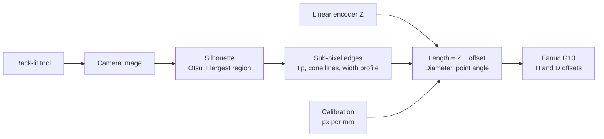

## Machine design (CAD)

- **Tool station:** the tool stands in its holder on a fixture, with a **back light** behind it, so the camera sees a sharp dark silhouette whatever the tool's colour or coating.
- **Z column:** the **camera** rides on a ball-screw Z axis. A **linear encoder** reads its true height, so stepper missed steps and backlash don't affect the measurement.
- **X/Y stages:** ball screws on linear guides with stepper motors (BF12 end supports), to bring the camera onto the tool axis.

## Measurement method

1. **Calibrate** `k` (pixels per mm): two clicks on a reference, or the width of a gauge pin of known diameter.
2. **Segment:** Otsu threshold, then the largest dark region (tool plus holder).
3. **Edges:** on every image row, the left and right silhouette edges to sub-pixel accuracy, by interpolating the intensity profile at the mid-grey level.
4. **Tip:** the top-most silhouette point, refined along the axis. For pointed tools, straight lines are fitted to the two cone edges and **their intersection is the tip**, which also gives the **point angle**.
5. **Length:**

   $$L = z_{encoder} + \frac{y_{reference} - y_{tip}}{k}$$

   At $z_{encoder}=0$ the camera's reference row (centre crosshair) lies on the gauge line. If the whole tool fits in one view, $z=0$ and $y_{reference}$ is simply the gauge line in the image.
6. **Diameter:** the width profile in a band behind the tip (moved past the drill point automatically), smoothed along the tool, then its 90th percentile, so flute lands count but sensor noise doesn't inflate it.
7. **Offsets:**
   ```
   G90;
   G10 L10 P12 R36.000;   (H12 geometry = tool length)
   G10 L12 P12 R5.000;    (D12 geometry = tool radius)
   ```
   *Gauge* convention: H = tool length (positive). *Touch-off* convention: H = L − (gauge line at Z home to work zero), which gives the large negative values on the offset screen above.

## Automated measuring cycle

Tools are often longer than the camera's field of view. The cycle steps the camera up the Z axis until the tip appears, centres the tip on the reference row (closed loop on the image), reads the encoder and measures:

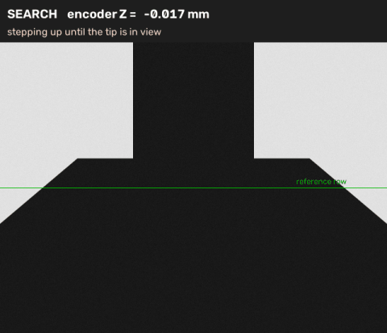

*Simulation:* `SimulatedStation` renders what the camera would see at each Z, with ±20 µm positioning error and a 1 µm encoder. A real station only has to provide the same three methods: `move_to`, `read_encoder` and `grab`. Tools from 32 to 210 mm long (with a 24 mm field of view) are found and measured in 4–14 moves, within 2.1 µm of their true length.

## Validation on synthetic images

To know the true answer exactly, the algorithm is tested on **synthetic** back-lit tool images. These are rendered from exact geometry with area-weighted, anti-aliased edges, plus sensor noise: flat end mills and drills with 90–140° points, 3–16 mm diameter, at 5–32 px/mm.

| Drill Ø10 × 36 mm, 118°: measured 36.000 / 10.000 mm / 118.0° | End mill Ø16 × 30 mm: measured 30.000 / 16.001 mm |
|---|---|
| 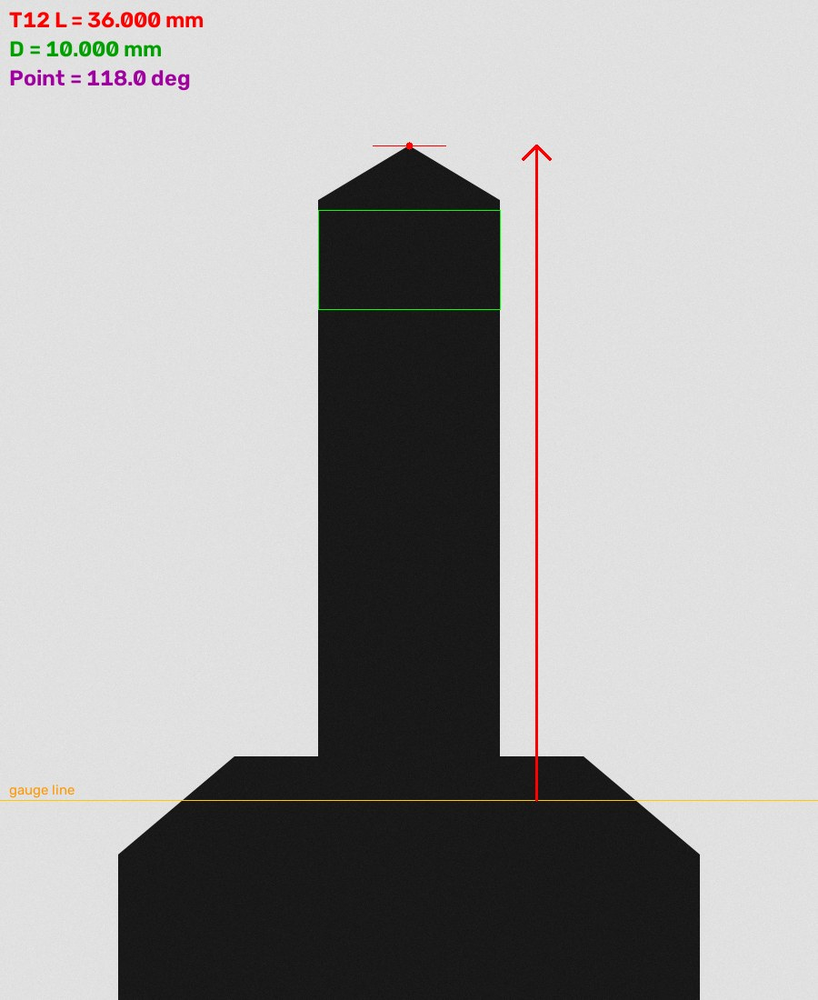 | 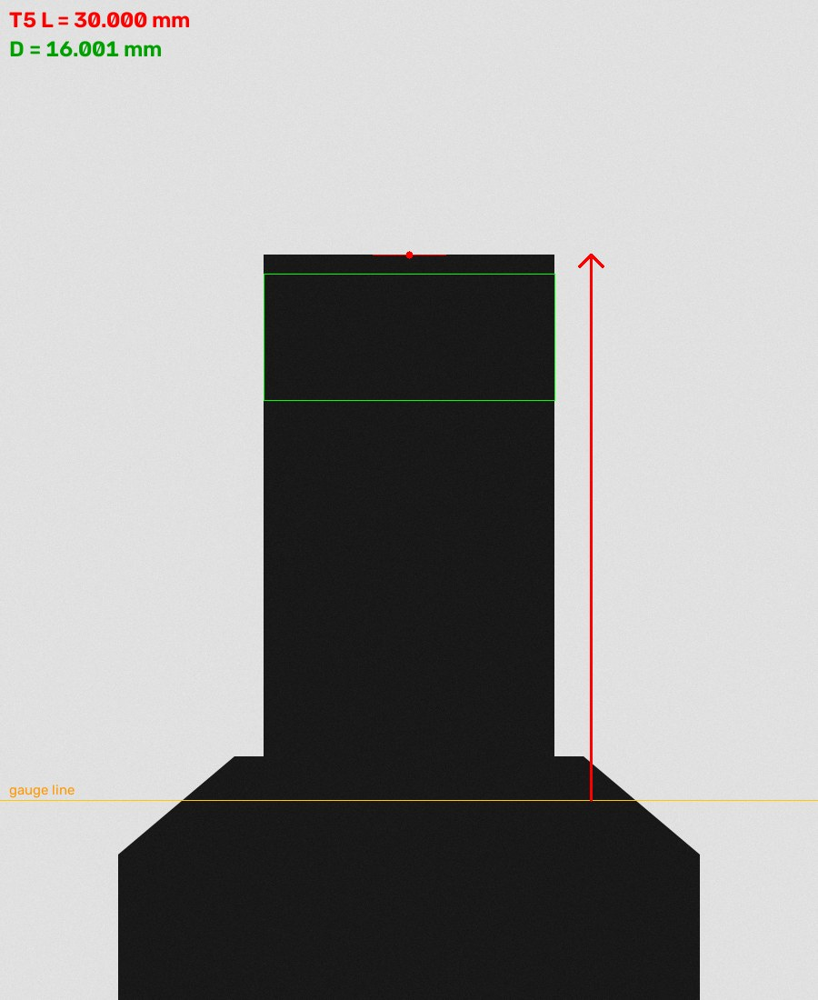 |

**Measurement-system study** ([`analysis/accuracy_study.py`](analysis/accuracy_study.py)): one factor varied at a time, 8 tools per point, plus 30 repeats for repeatability.

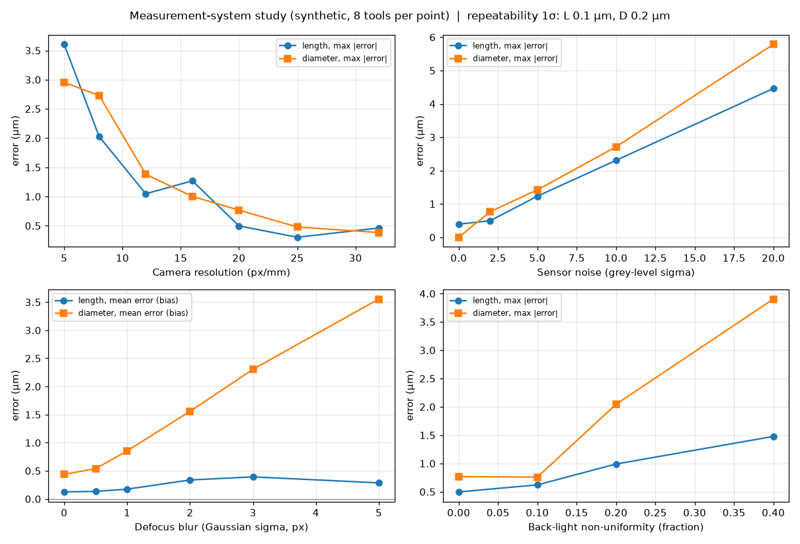

| Finding | Result |
|---|---|
| Algorithm error floor at 20 px/mm | < 1 µm length, < 1 µm diameter, point angle within 0.1° |
| What matters most | **Sensor noise** and **resolution**. Errors scale roughly with noise σ and with 1 / (px per mm) |
| Defocus | Diameter bias +1.6 µm at 2 px blur. **Length is unaffected**: an earlier version read drills **24 µm short** at 2 px blur, fixed by taking the tip from the fitted cone edges |
| Uneven back light (±20 %) | Diameter within 2 µm, so the local mid-grey level copes with gradients |

> **What these numbers mean:** they are the *algorithm's* floor on ideal images. On real hardware the error budget is dominated by the optics and the mechanics: lens distortion, **perspective error** (a normal lens magnifies nearer objects more, while a telecentric lens doesn't), diffraction at the edges, back-light quality, vibration and temperature. Real-tool validation against a commercial presetter is the next step.

## Software

| File | What it does |
|---|---|
| [`app.py`](app.py) | Interactive measuring station (camera or still image): calibration, centre-reference crosshair, auto contour width/height, contour and multi-point measuring with edge snapping, camera-shift tracking (optical flow), **tool measurement (M)** and **gauge-line picking (G)** with G10 output |
| [`measure_tool.py`](measure_tool.py) | Command line: measure a tool in a saved image, print length, diameter, point angle and G10 lines, save an annotated image |
| [`tool_offsetter/measure.py`](tool_offsetter/measure.py) | Silhouette, sub-pixel edges, tip and cone fit, length, diameter, point angle, profile |
| [`tool_offsetter/automation.py`](tool_offsetter/automation.py) | Automated search, centre and measure cycle, plus the simulated station |
| [`tool_offsetter/calibration.py`](tool_offsetter/calibration.py) | Two-point and gauge-pin calibration, calibration file |
| [`tool_offsetter/offsets.py`](tool_offsetter/offsets.py) | Fanuc G10 lines and offset-loading program |
| [`tool_offsetter/synthetic.py`](tool_offsetter/synthetic.py) | Exact synthetic tool images for testing |
| [`analysis/`](analysis/) | Measurement-system study |
| [`tests/`](tests/) | 11 tests, run automatically on every push (GitHub Actions) |
| [`legacy/`](legacy/) | Vision Measurement System V3.1, the original program this project grew from |

### Run it
```bash
pip install -r requirements.txt
python app.py --camera 0                      # live camera (index 1 = external USB camera)
python app.py --image examples/synthetic_drill.png --tool 12
python measure_tool.py photo.jpg --px-per-mm 20 --gauge-y 880 --tool 12 --out result.jpg
python -m pytest tests                        # 11 tests
python analysis/accuracy_study.py             # regenerate the study
```

**App keys:** live view: `S` capture, `C` calibrate, `T` track camera shift, `D` clear calibration, `Q` quit. Captured frame: `M` measure tool, `G` set gauge line, `Y` accept, `N` reject (then `1` contour / `2` multi-point, `K` snap, `Z` undo), `R` back to live.

## Status and roadmap
- [x] Mechanical design of the complete presetter (Fusion 360)
- [x] Vision measuring software: calibration, manual and automatic modes
- [x] Tool length, diameter, point angle, Fanuc G10 output
- [x] Automated search, centre and measure cycle (simulated station)
- [x] Measurement-system study and automated tests
- [ ] Real-tool validation against a commercial presetter (repeatability and bias on real drills and end mills)
- [ ] Build the stages: stepper control and linear-encoder read-out behind the `Station` interface
- [ ] Lens-distortion calibration (checkerboard); evaluate a telecentric lens
- [ ] Runout by rotating the tool; send offsets to the CNC over DNC / RS-232

## Credits
Developed by **Ameen** ([@ameeniszath](https://github.com/ameeniszath)), M.Tech (Manufacturing Engineering), IIT Madras.
Built with [OpenCV](https://opencv.org) and NumPy; CAD in Autodesk Fusion 360.
